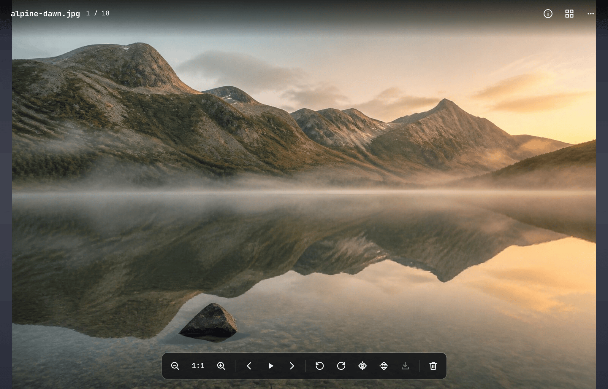
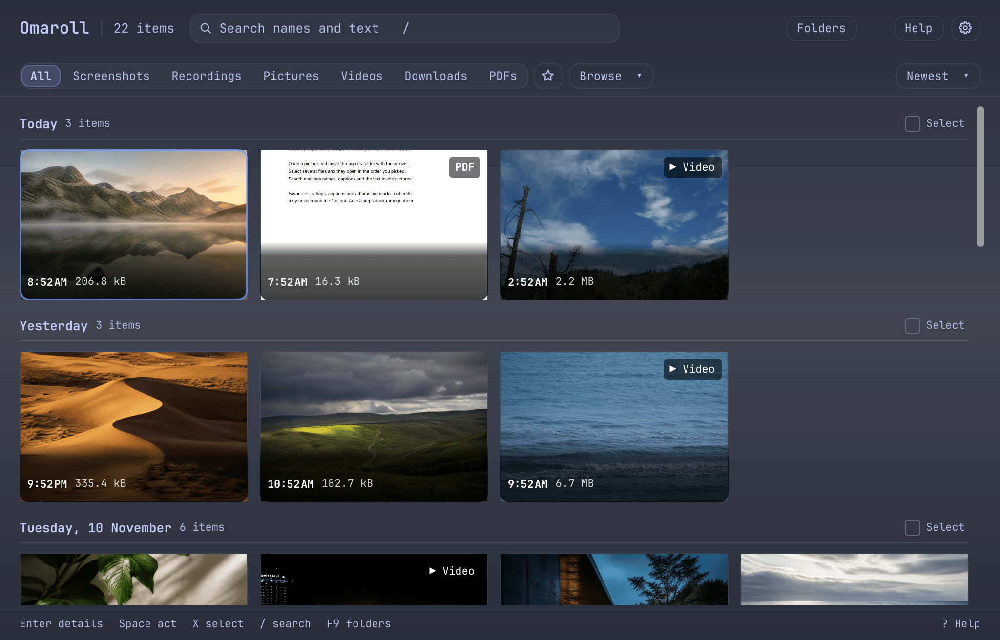
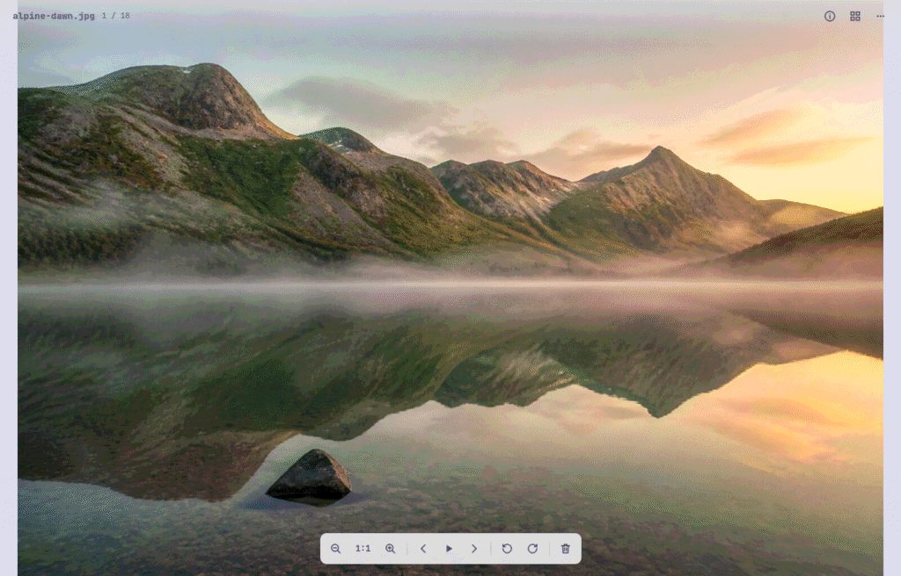
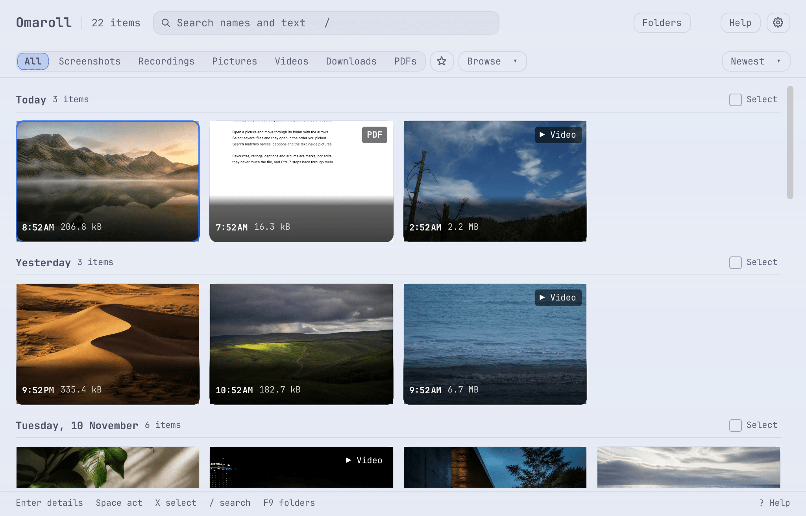
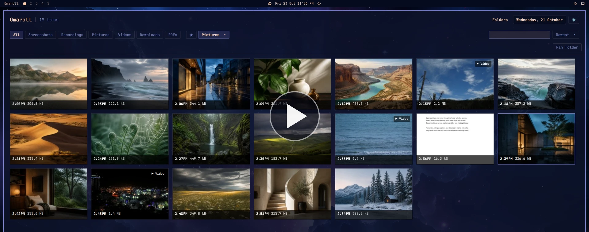
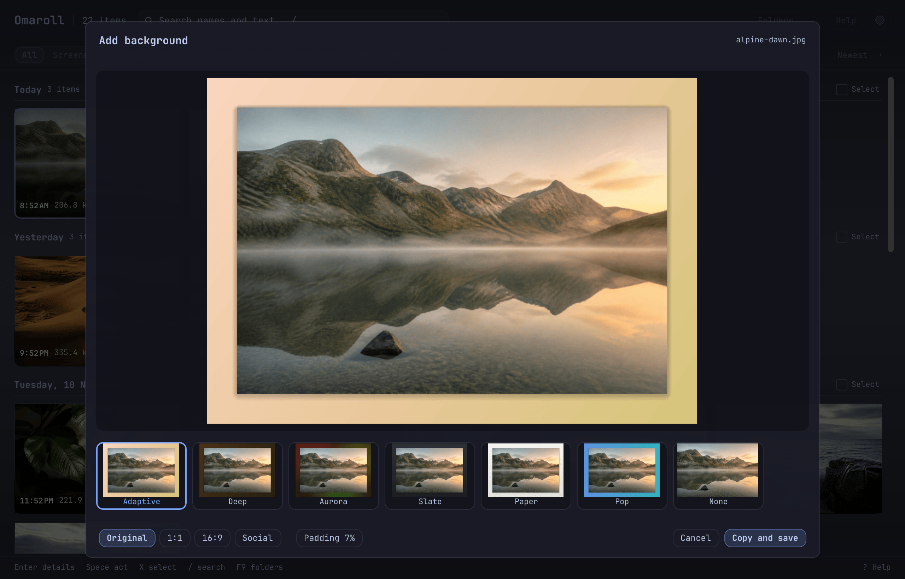

<p align="center">
  
</p>

# Omaroll

[](https://github.com/btsouth/omaroll/actions/workflows/ci.yml)
[](LICENSE)

**A photo and video viewer as good-looking as the rest of Omarchy.**

Double-click a picture or video and it opens in a viewer that follows your
theme, with the rest of the folder an arrow key away. Press Enter for the
library: photos, videos, PDFs, screenshots and recordings together, with albums,
tags and search, even for the text inside pictures. Your files stay where they are.

Everything works locally, without accounts or telemetry.

> Omaroll is an independent community project, not an official Omarchy application.

[Quick start](#quick-start) · [Install](#install-or-update) · [Features](#features) · [Shortcuts](docs/shortcuts.md) · [Changelog](CHANGELOG.md) · [Homepage](https://btsouth.github.io/omaroll/)

## Quick start

1. Install Omaroll. On Omarchy's edge channel, run `sudo pacman -S omaroll`.
   On other channels and plain Arch Linux, use the signed repository
   ([details](#install-or-update)):

   ```bash
   curl -fsSL https://pkgs.btso.dev/install.sh | bash -s -- omaroll
   ```

2. Make it the default for pictures and videos. `omaroll --unset-default` puts
   the previous apps back.

   ```bash
   omaroll --set-default
   ```

3. Double-click a picture or video in your file manager, or run
   `omaroll photo.jpg`. Run `omaroll` on its own for the library.
4. Press `?` or `F1` in the library or the viewer for its shortcuts. Close any
   open sheet or menu first.
5. Optional: Omarchy dims every window a little. To keep pictures at full
   opacity and float the viewer, add Omaroll's Hyprland rules.
   `omaroll --remove-window-rules` takes them out, and Settings has the same
   switch.

   ```bash
   omaroll --install-window-rules
   ```

| | Quick viewer | Library |
|---|---|---|
| Dark |  |  |
| Light |  |  |

[](https://btsouth.github.io/omaroll/docs/omaroll-demo.mp4?v=1.18.0)

[Watch the 38-second demo](https://btsouth.github.io/omaroll/docs/omaroll-demo.mp4?v=1.18.0)

Something wrong? Copy diagnostics from **About** in Settings, or run
`omaroll --diagnostics` if no window opens, and paste it into a
[bug report](https://github.com/btsouth/omaroll/issues/new/choose).

## Install or update

Requires Omarchy or Arch Linux on x86_64 or aarch64, with Qt 6.8+ and Poppler.

On Omarchy, Omaroll is in the official package repository:

```bash
sudo pacman -S omaroll
```

It is on the edge channel now and reaches rc and stable as Omarchy promotes
them. Until then, or on plain Arch Linux, use my signed package repository:

```bash
curl -fsSL https://pkgs.btso.dev/install.sh | bash -s -- omaroll
```

This adds the [repository](https://github.com/btsouth/pkgs), so Omaroll then
updates with the rest of your system (`omarchy update` on Omarchy,
`sudo pacman -Syu` on plain Arch).
Once Omarchy's repository carries Omaroll on your channel, updates come from
Omarchy instead, with nothing to change. If you installed an earlier release by
hand, run the same command to start getting updates.

To install one release without adding the repository:

```bash
curl -fLO https://github.com/btsouth/omaroll/releases/download/v1.18.0/omaroll-1.18.0-1-x86_64.pkg.tar.zst \
     -fLO https://github.com/btsouth/omaroll/releases/download/v1.18.0/SHA256SUMS
sha256sum -c --ignore-missing SHA256SUMS
sudo pacman -U ./omaroll-1.18.0-1-x86_64.pkg.tar.zst
```

On ARM, replace `x86_64` with `aarch64` in the package name.

A package installed this way does not update on its own. Run the same commands
for a newer release.

If you prefer a browser, download the package and `SHA256SUMS` from the
[latest release](https://github.com/btsouth/omaroll/releases/latest), put them
in the same folder, then run the last two commands above from that folder.

On another Arch Wayland desktop, install `qt6-wayland` if it is missing. For a
source build, see [Development](#development).

The release includes build provenance. To verify the package with GitHub CLI:

```bash
gh attestation verify omaroll-1.18.0-1-x86_64.pkg.tar.zst --repo btsouth/omaroll
```

## Open files

To make Omaroll the default for pictures and videos, run:

```bash
omaroll --set-default
```

It prints how many types changed and the command that undoes it, even if some
types could not be changed; add `--verbose` to list every type.
`omaroll --unset-default` puts back the apps it replaced.
`omaroll --set-default pdf` does the same for PDFs, and
`omaroll --unset-default pdf` undoes that. Folders keep opening in your file
manager.
Settings has the same choice as **Set as default** and **Restore previous
apps**, and says how many types changed and which apps were replaced.

To open a picture or video from a terminal:

```bash
omaroll photo.jpg
omaroll clip.mp4
```

Video captions use Omaroll's themed overlay for embedded tracks and sidecars.
The info panel identifies PQ/HDR10, HLG and Dolby Vision metadata when present;
this describes the file, not a guarantee of HDR display output. Open in mpv
continues at the current playback position. When changing videos, a poster or
the previous picture stays visible until the new clip's first decoded frame.

Hovering the seek bar, in the viewer or the library preview, shows the time
under the pointer and, above it, the nearest of up to 100 sampled keyframes, so
the picture can be a few seconds from that time on a long video. Once a video is
playing, Omaroll has ffmpeg decode those keyframes in the background, at low
priority and at most two at a time, and waits while you seek. Only the focused,
unminimized window decodes; what's done so far is kept when you switch away.
They're cached, so a video opened again has previews at once. Clips under five
seconds and audio-only files show the time alone.

A picture or video opens in the viewer: the media fills the window, a small
picture included, and the name, the controls and the menu appear when the
pointer moves. Rotating and flipping turn the view only. Once the view is
turned or flipped, **Save rotated copy** (`Ctrl+S`, or the save button in the
toolbar) writes `name-edited.ext` beside the original, with the original's
permissions, and opens it; the original is never changed. A JPEG is turned
losslessly with `jpegtran` when its size allows, with an EXIF orientation tag
folded into the same turn, and keeps its EXIF (date taken, camera, place)
marked upright. The notice says when the copy had to be re-encoded, when it is
saved in another format (a GIF is saved as PNG) and when metadata could not be
kept. A lossless WebP stays lossless.
Pictures and videos in the folder are listed by filename; press `B`
for a filmstrip of them above the controls, and click one to open it. Use the arrows
to step through pictures, or Page Up and Page Down to change files while a video
is playing. Folders, PDFs and a plain `omaroll` open the library, and so does
`--library` with any file:

```bash
omaroll ~/Pictures
omaroll --library photo.jpg
```

Images and videos without a filename extension are recognized from their file
headers. Their names stay unchanged; unrelated files are ignored.

A picture that can't be shown says why: not a picture at all, a format no
installed plugin reads, a damaged or cut-off file, or one too large for the
memory limit. Open with, Show in folder and Move to Trash stay available, and
the zoom and rotate controls are off. A JPEG or PNG that ends early, as an
unfinished download does, shows with a "cut off" note, since the missing part
otherwise looks like grey picture. In the filmstrip such files are marked.

Drag the file name in the viewer's header, or `Ctrl`+drag the picture, to drop
the file itself into a file manager, browser or chat; a plain drag still pans.
Drop pictures or videos on a viewer to open them there, with skipped files
named. Drop files on the library to open them in the viewer, or folders to add
them to the library after a confirmation.

`Tab` and `Shift+Tab` move through the viewer's controls with a focus ring,
then back to the picture; `Esc` returns to the picture. The viewer's shortcuts
keep working while a control has focus. In the filmstrip, the arrows move the
ring and `Enter` opens the file under it.

To start a video in the viewer at a given time, use `--start` with seconds,
mm:ss or hh:mm:ss. It applies to the first video you open and takes precedence
over the saved position:

```bash
omaroll --start=1:23 clip.mp4
```

File managers can pass the same option to hand over a preview's position.

Several files can be opened together, in the order given:

```bash
omaroll first.jpg ~/Pictures/second.png third.webp
omaroll -- ./-unusual-name.png
```

Multiple files stay in the supplied order across folders, including when an
existing window receives them. Explicitly selected hidden files can be opened
without scanning every surrounding folder. Each file opened from outside gets
its own viewer, so two pictures can sit side by side; opening one that is
already up brings its viewer forward. The library and viewers share one
process, so a favourite or rating set in one shows in the others.

Every viewer shortcut is listed in [Shortcuts](docs/shortcuts.md#viewer), and
`?` shows them in the viewer.

## Features

- **Browse your media.** See files by day, source or folder; filter by kind,
  date, camera or lens, combine those filters, and resize the grid. Date sorts put a header over each
  day, or over each month where days hold less than half a row or tiles are at
  the two smallest sizes, with the count and a Select control for that day.
  Tiles from other days show their date. Original photo and video dates are
  used when available. Add folders without importing or copying their files.
- **Organize without changing originals.** Albums, nested tags, captions,
  favourites, ratings and saved searches live in Omaroll's settings. Undo marks
  and moves to Trash with Ctrl+Z, and back up or restore your organization from Settings.
- **Find words in pictures and PDFs.** One search box covers names, picture
  and PDF text, captions, tags, albums, folders and cameras, ignoring accents.
  Narrow it with `tag:`, `in:`, `camera:`, `type:` or `before:`, quote a
  phrase or leave out a `-word`. Reuse or clear the private text cache.
- **Preview images, video and PDFs.** Zoom, pan, rotate and flip pictures, in
  their real colors when they carry a wide-gamut profile; play video with sound,
  seek-bar previews, frame stepping, speed, audio tracks and subtitles; search PDF
  text, select words to copy, and switch between continuous scrolling and fit page.
- **Make corrections as copies.** Crop with aspect presets, straighten,
  rotate, flip and resize one image or a selection. Save a copy or copy a region.
  Lossless JPEG turns use `jpegtran` when possible; other corrections save a
  recompressed copy.
- **Review duplicates.** Compare exact copies or similar pictures side by side,
  with size, date and folder under each. Keep one and send the others to Trash
  after confirmation, as one step Undo puts back.
- **Share and hand off.** Drag actual files into another app, copy images or
  text, send with LocalSend or Taildrop, and open specialist tools for trimming,
  annotation, conversion and editing.
- **Present and finish.** Run a fullscreen slideshow, choose a screenshot
  background for sharing, and follow your Omarchy palette and font as they change.

Settings, the gear in the library header, is grouped into Library,
Viewer, Video, Search and text, Albums and backups, Integration and About, with
a side index on a wide window and a switch for each on/off choice. Nothing in
it is needed for Omaroll to work.

## Library actions

The library offers actions for the current file or selection: trim, convert,
annotate, extract text, add a background, set as the desktop background,
print, send, rename and more. Omaroll handles organization and safe copies
itself and hands specialist work to tools such as `omacut`,
`omarchy-transcode`, Tensaku, Omaframe and Tesseract. An action whose tool is missing is greyed with the
package to install, and **About** in Settings lists every missing tool with its
`pacman` command.

A move to Trash can be undone with **Undo** on the notice that follows it, or
with `Ctrl+Z`. `Shift+Delete` skips Trash and asks first by default.

[Library actions](docs/actions.md) lists every action and its handler, with
RAW editors, RAW and JPEG pairs, pinned folders and the preview.

## Search

The search box matches filenames, captions, tags, albums, folders, cameras
and the text inside pictures and PDFs, ignoring accents, with fields such as
`tag:`, `in:` and `before:`. Picture text is read locally by Tesseract.
**Similar pictures** in Browse groups resized,
recompressed or brightened copies and close bursts, and Compare puts a set side
by side so you can keep one. Nothing is removed without a confirmation.
[Search and similar pictures](docs/search.md) explains the search fields, indexing,
match levels and the caches.

## Mattes



Adaptive and Deep are gradients built from the capture's dominant hue, Aurora is
a soft mesh, Slate and Paper are neutrals, Pop is the complementary hue, and None
keeps the raw capture. Deterministic per file: the same
screenshot always offers the same six.

The original is never touched. The composite is written as a new file beside it
and put on your clipboard.

## Library shortcuts

Every library and preview shortcut is listed in
[Shortcuts](docs/shortcuts.md#library-and-preview), and `?` shows them in the
library.

## Formats

Images: PNG, JPEG, WebP, animated GIF and WebP, BMP, AVIF, HEIC/HEIF, TIFF,
SVG/SVGZ, ICO, JXL, JPEG 2000, QOI, PSD, DDS, EXR, and TGA.
TGA support depends on the installed Qt plugin; uncompressed Truevision 2.0
files work, while older files without the footer may not.

Camera raws: ARW, CR2, CR3, CRW, DNG, NEF, NRW, RAF, ORF, RW2, PEF, SRW and the
other formats LibRaw reads, through the kimageformats raw plugin when `libraw`
is installed. Thumbnails, the library and the viewer show the camera's embedded
JPEG, turned upright, which most cameras write at full size; a raw without one
gets a quick half-size decode instead. The viewer demosaics the raw only when
the preview would be shown larger than it is.
RAW tiles show their camera format. Develop opens an installed darktable,
RawTherapee or ART; `D` does the same in the viewer. The library shows an install
hint when none is available.
Raws are never written: annotation, recognition, ordinary image editors, background,
print and corrections are not offered for them, and Convert · resize makes a
JPEG or PNG beside the raw instead.

Very large pictures, such as 150-megapixel scans, open from a copy the size of
the screen. Zoomed past it, a JPEG decodes only the part on screen, so even a
picture too long for the graphics card is sharp; other formats load full
resolution when there is memory for it. Omaroll lets one
picture use up to an eighth of the computer's memory, between 256 MiB and
2 GiB; a picture that needs more says how much. Set `QT_IMAGEIO_MAXALLOC` to a
number of megabytes to choose the limit yourself. JPEG always opens, at a
reduced size if necessary; other formats have to fit the limit to open.

Videos: MP4, M4V, F4V, MKV, WebM, MOV, AVI, DivX, MPEG, VOB, WMV, ASF, FLV,
Ogg video, OGM, 3GP, 3G2 and MTS/M2TS. Playback uses Qt's FFmpeg backend by
default, decoding in hardware where the driver allows (CUDA on NVIDIA,
otherwise VA-API) and in software otherwise. With FFmpeg, Qt copies each
decoded frame back to main memory, so 4K video costs more CPU than in mpv; see
[playback cost](docs/performance/2026-11-09-playback-cost/README.md).
`QT_MEDIA_BACKEND=gstreamer` picks Qt's GStreamer backend instead, which those
notes don't cover. An optional action can still hand the file to mpv.

Documents: PDF. Thumbnails, previews, and page counts use Poppler locally.

## Theme and window rules

Omaroll paints its own translucent chrome from your theme and draws every
thumbnail fully opaque on top. Omarchy dims all windows slightly by default,
which would wash out the pictures, so Omaroll opts out the same way mpv, imv and
Pinta do. Its rules also float the viewer, centred, the way Omarchy floats imv
and mpv; the viewer then opens at most of the screen's size, and the library
keeps its tile. To add them:

```bash
omaroll --install-window-rules
```

This writes a copy of `/usr/share/omaroll/hypr/omaroll.lua` to
`~/.config/hypr/` and adds a short block to `~/.config/hypr/hyprland.lua` that
loads it if it is there.
`omaroll --remove-window-rules` takes both out again, leaving `hyprland.lua`
exactly as it was, and **Hyprland window rules** in Settings does either. It
needs Omarchy's Lua Hyprland config. A line of your own that only says
`require("hypr.omaroll")` is removed too; any other line that loads the rules is
reported and left for you to edit. A `~/.config/hypr/omaroll.lua` you wrote
yourself is never replaced or removed.

When a second viewer opens on the same workspace, Omaroll tiles it and the
viewers already there, so your layout arranges them instead of stacking them in
the middle. They stay tiled as the others close; the next viewer opened on its
own floats again.
A viewer opened this way maps under the library's title, "Omaroll", for a
moment before taking its own, so rules you have keyed on that exact title also
apply to it.

## First run

With nothing in Pictures or Videos yet, the library offers **Add folder**,
**Open file** (the desktop's file chooser), **Try the demo library** and, when
Omaroll isn't already the default for pictures, **Set as default viewer**. Files
stay where they are; Omaroll never moves or copies them. A search or filter
that matches nothing says so and offers **Clear search** or **Clear filters**,
rather than calling the folder empty.

## Try it without your own files

```bash
omaroll --demo
```

Builds a deterministic fictional library in a temp directory and browses that
instead. It includes a resized copy and a short burst, so Similar pictures and
Compare have sets to show. Nothing personal appears on screen, which is also
how every screenshot in this repository is made.

```bash
omaroll --render shot.png --render-view matte
```

Renders a view to a PNG and exits. Views include `grid`, `grid-filenames`,
`detail`, `document`, `video`, `matte`, `similar`, `compare`, `viewer` and
`viewer-video`; see [validation](tests/README.md) for the full render matrix.
It grabs the scene graph rather than the screen, so an overlapping window
cannot spoil the shot. `man omaroll` lists every option with examples.

## Design notes

- **Read-only on discovery.** Browsing, indexing, duplicate review and previews
  never change media. A file changes location only when you explicitly rename
  it or move it to Trash. Generated work is written beside the original.
- **Offline.** Nothing in the core path touches the network. No telemetry, no
  sync, no accounts.
- **High DPI.** Thumbnails are generated at `devicePixelRatio` and the cache is
  keyed on the rendered pixel size, so a 1.25x or 1.5x monitor gets crisp tiles
  rather than upscaled ones.
- **Playback cost.** A 4K60 video plays with hardware decoding at about 22%
  of a core for H.264 and 41% for 10-bit HEVC on an NVIDIA RTX 4070 SUPER,
  in line with a plain Qt player; mpv uses 6 to 8% there because it keeps
  frames on the graphics card. See
  [the measurements](docs/performance/2026-11-09-playback-cost/README.md).
- **Cache and state.** Thumbnails in `~/.cache/omaroll/thumbs`, bounded at 256MB
  by default, configurable from 64MB to 1GB, and pruned least-recently-used.
  Embedded media dates use a small identity-checked index in the same cache
  root, so unchanged files are not inspected again on every launch. Seek-bar
  previews are in `~/.cache/omaroll/storyboards`, readable only by you, keyed
  by path, size and modification time, bounded at 64MB and pruned
  least-recently-used. A changed file gets new previews; the old version's stay
  until they're pruned.
  Settings and organization live in `~/.config/omaroll` (`$XDG_CONFIG_HOME/omaroll`
  if that is set). Deleting that directory
  also removes albums, tags, favorites and saved views. Back it up first if you
  want to keep them. Omaroll also keeps automatic backups of your organization
  in `~/.local/share/omaroll/backups` (7 daily, 4 weekly, readable only by you).
  Today's is refreshed a few minutes after each change and at exit. If a
  launch finds the settings damaged or emptied, it offers to restore one;
  Settings has Restore last good backup, and Import reads any of them. The thumbnail cache can be deleted and regenerated.

## Development

On Arch, install the build and runtime dependencies:

```bash
sudo pacman -S --needed git base-devel cmake ninja pkgconf bubblewrap \
  qt6-base qt6-declarative qt6-multimedia qt6-imageformats qt6-svg qt6-wayland \
  kimageformats libavif libheif libraw hicolor-icon-theme xdg-desktop-portal \
  ffmpeg ffmpegthumbnailer poppler wl-clipboard xdg-utils
```

```bash
git clone https://github.com/btsouth/omaroll.git
cd omaroll
cmake -S . -B build/release -G Ninja -DCMAKE_BUILD_TYPE=Release
cmake --build build/release
bash tests/run-isolated.sh build/release
```

To install a source build, run `sudo cmake --install build/release`. Use the
release package above if you want installation managed by pacman.

See [Contributing](CONTRIBUTING.md), [validation and desktop acceptance](tests/README.md),
[project status](docs/STATUS.md), [the roadmap](docs/ROADMAP.md), and
[the release process](RELEASING.md). Use disposable media for checks that rename,
edit or trash files.

## More for Omarchy

- [Omakade](https://github.com/btsouth/omakade): your Steam, Heroic, Lutris and emulator games in one library.
- [Omaframe](https://github.com/btsouth/omaframe): screenshots and screen recordings, with frames and backgrounds.
- [Omalink](https://github.com/btsouth/omalink): your Android phone on the desktop, through KDE Connect.

## License

MIT. See [LICENSE](LICENSE).
