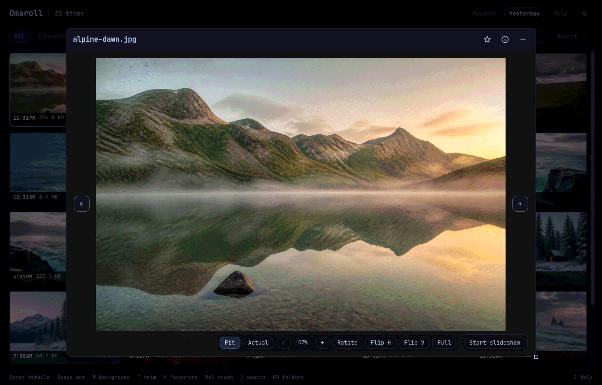

# Library actions

The library offers actions for the current file or selection. Omaroll handles
organization and safe copies itself, and hands specialist work to these tools.
An action whose program is missing is shown greyed with the package to install,
and **About** in Settings lists every missing tool with its `pacman` command.

| Capture | Action | Handler |
|---|---|---|
| Recording | Trim *(default)* | `omacut` |
| Recording | Convert · resize | `omarchy-transcode` |
| Recording | Open in mpv | `mpv` |
| Recording | Save current frame | `ffmpeg`, from the viewer position |
| Image | Add background | native, no external app required |
| Screenshot | Annotate | `$OMARCHY_SCREENSHOT_EDITOR`; Tensaku by default |
| Image | Open in Omaframe | `omaframe`: annotation, borders, backgrounds and frames |
| Screenshot | Extract and select text | `tesseract` |
| Image | Convert · resize | `omarchy-transcode` |
| Image | Edit · View | `pinta` · `imv` |
| Image | Set as background | `omarchy-theme-bg-set` |
| Image | Copy QR content (only after detection) | `zbarimg` |
| Image | Crop, rotate, resize · Copy region | native |
| Image | Correct a selection | native |
| Image | Compare side by side | native |
| Image or PDF | Print | `lp` (CUPS) |
| PDF | Open document *(default)* | `sushi` |
| Any | Open in Omaroll · Albums and tags | native |
| Any | Rename in place | native, extension preserved |
| Any | Copy image or file | PNG pixels; a JPEG as itself and as PNG, so it reaches clipboard history; otherwise file URIs (`wl-copy`) |
| Any | Send with LocalSend | `omarchy-menu-share` |
| Any | Send to a machine | `omarchy-tailscale-send`, after picking the machine |
| Any | Show in file manager | select the file in the configured folder handler when supported, or open its folder through `xdg-open` |
| Any | Open with… | desktop application chooser, without changing MIME defaults |
| Any | Move to Trash | XDG trash, never `unlink` |

Single-file menus include viewing and editing actions. Selection menus offer
only actions supported for every selected file, including printing pictures
and PDFs. Menu shortcuts act on the same captured targets as clicks.

**Open with** passes the original file to the application you choose. Saving
in an editor can change that file. It requires a desktop portal that supports
the application chooser; if unavailable, Omaroll reports an error.

A move to Trash can be undone with **Undo** on the notice that follows it, or
with `Ctrl+Z`, which takes back whatever happened last: a mark or a move to
Trash. A batch or a duplicate cleanup comes back as one step, and a file
returns to its place in the viewer. Undo puts back only the file that was
trashed and never replaces a file that has since taken its name; if the Trash
was emptied or the name is taken, it says so and leaves both alone. If the
file changes or is replaced while the Trash prompt is open, the prompt refuses
instead of trashing the newcomer.

`Shift+Delete` skips Trash and cannot be undone. Both viewers and the library
ask for confirmation by default. **Confirm permanent deletion** in Settings
can turn that prompt off; regular `Delete` continues to use Trash and its
existing confirmation. Permanent deletion removes the chosen file or symlink, or the checked files,
without automatically including RAW/JPEG companions.

The image and video defaults, including whether slideshows include videos, can
be changed in Settings.

When `$OMARCHY_SCREENSHOT_EDITOR` is unset or set to `tensaku-edit`, Omaroll
uses Tensaku directly with a new output path.

**Open in Omaframe** is available for existing images in the library and quick
viewer. It opens the image in Omaframe's studio for annotation or a frame,
border and background. Omaframe saves a new PNG in its chosen output folder
and copies it to the clipboard, leaving the source unchanged. This action
does not change the configured annotation editor. You can choose it as the image action
in Settings; Space runs that action. Enter and double click open the built-in preview.
Right click opens actions for the pointed file or its existing selection.

Camera RAWs can open in darktable, RawTherapee, ART, digiKam, GIMP or a custom
command. Choose an editor from the menu, use its star to save a preference,
or enable **Always ask**. Custom commands accept `{path}` in an argument of a direct editor command;
without it, Omaroll appends the file path. Shell commands and `env` wrappers are
refused. Use a wrapper script for shell logic. Use double quotes around arguments
containing spaces. Omaroll passes arguments directly without a shell.

Matching RAW and JPEG files in the same folder appear as one item by default.
The companion action switches between the originals; rename and Trash act on
the file being viewed. Ambiguous matches stay separate, and duplicate reviews
show both files. Turn grouping off in Settings to show every file separately.

Pin a folder in Settings or from its library view to add a shortcut above the
grid. Pinning also adds that folder as a library source. Unpinning removes only
the shortcut, leaving the source and files alone.

The medium decides the list, not the folder: a downloaded clip gets the
recording actions and a downloaded photo gets the image actions.

Turn on Show filenames in grid in Settings to keep names visible on thumbnails.
Long names are shortened with an ellipsis; hover or keyboard focus shows the full name.

Gallery previews open with a compact header. Drag an edge or the bottom-right
corner to resize the preview; Omaroll remembers the size and fits it to the window.
Wheel and pinch zoom keep the point under the pointer fixed, including in Compare.
Toggle the inspector for ratings, captions and file details, or use the overflow
menu for other actions. Copy path and Copy file name copy plain text for the opened
entry, preserving a symlink's name and path.

